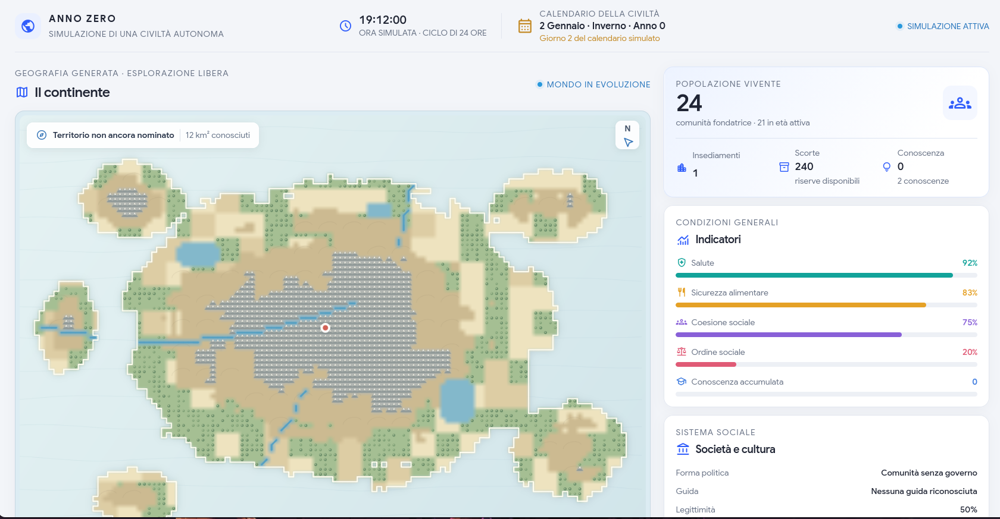

# WORLD — Open Exploration



WORLD è un mondo 3D stilizzato a poligoni morbidi, con visuale in prima persona predefinita e terza persona selezionabile. Comprende terreno continuo, pianure abitabili, villaggio, abitanti e un portale verso la Valle delle Stelle.

## Avvio su Linux

Non servono Node.js, pip, installazioni o compilazioni. È sufficiente Python già presente nel sistema.

1. Clona il repository (solo la prima volta) oppure entra nella cartella già clonata:
   ```bash
   git clone https://github.com/JonaDev2026/world3d.git
   cd world3d
   ```
   Per gli aggiornamenti successivi:
   ```bash
   cd world3d
   git pull
   ```
2. Avvia un piccolo server locale:
   ```bash
   python3 -m http.server 8000
   ```
3. Apri Firefox su http://localhost:8000
4. Crea il personaggio scegliendo nome, lingua e colori; poi entra nel mondo.

Three.js viene caricato da jsDelivr: serve una connessione Internet.

## Comandi

| Tasto | Azione |
|---|---|
| Freccia su / W | Avanti |
| Freccia giù / S | Indietro |
| Freccia sinistra / destra | Ruota |
| A / D | Movimento laterale |
| Mouse | Guarda intorno (prima persona) / ruota la visuale (terza persona) |
| Spazio | Salta |
| Shift | Corri |
| P | Salva un luogo |
| E | Attraversa il portale quando sei vicino |
| M | Apri la mappa dal menu pausa |
| Esc | Apri / chiudi il menu pausa |

Puoi anche usare il pulsante **SALVA LUOGO** nell'interfaccia.

Per fermare il server torna al terminale e premi Ctrl+C.

## Personaggio e lingue

Alla prima visita puoi creare un viaggiatore scegliendo nome, tonalità della pelle, capelli e vestiti. Durante la creazione è visibile un'anteprima 3D rotante che si aggiorna mentre cambi pelle, capelli e vestiti. In gioco la visuale predefinita è in prima persona; puoi passare alla terza persona dal menu pausa con ESC. L'interfaccia è disponibile in italiano, inglese, spagnolo e francese. I testi sono separati in `lang/it.json`, `lang/en.json`, `lang/es.json` e `lang/fr.json`.

## Menu pausa e impostazioni

Premi ESC o il pulsante pausa per aprire il menu. Da qui puoi riprendere la partita, aprire la mappa e configurare la visuale, la lingua, musica ed effetti sonori. I controlli audio sono già predisposti; la riproduzione verrà collegata quando saranno disponibili le tracce e gli effetti.

## Salvataggi

Personaggio, lingua, posizione e luoghi salvati vengono conservati nel localStorage del browser sul tuo dispositivo. Non vengono sovrascritti da `git pull` e non vengono caricati nel repository.

## Struttura

- `index.html` — struttura della pagina.
- `css/style.css` — stile e interfaccia.
- `js/main.js` — mondo 3D, personaggio, movimento e salvataggi.
- `js/i18n.js` — caricamento delle traduzioni.
- `lang/` — file lingua italiano, inglese, spagnolo e francese.

## Stato

**0.5 — The Player's Realm**

Terreno continuo con superfici poligonali, pianura del villaggio, case appoggiate al suolo, acqua separata dalle aree edificabili, alberi e personaggi low-poly più morbidi. Il mondo iniziale misura 96 × 96 unità: assumendo 1 unità = 1 metro, circa 9.216 m² (0,0092 km²). Comprende anteprima 3D live del personaggio, prima persona predefinita, terza persona selezionabile, menu pausa e impostazioni in quattro lingue (IT/EN/ES/FR).
