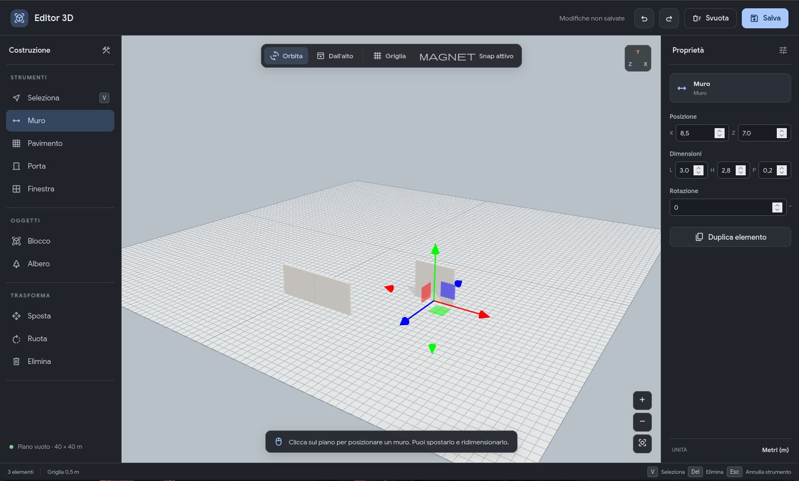

# World3D

World3D è un editor 3D di costruzione che permette di progettare e modificare una scena partendo da un piano vuoto. L'interfaccia è pensata per un flusso di lavoro semplice e immediato, ispirato alla modalità Costruisci dei simulatori di architettura e di vita.

## Cosa puoi fare

### Costruire
- Partire da un piano vuoto con dimensioni predefinite di 40 × 40 metri.
- Inserire muri, pavimenti, porte, finestre, blocchi e alberi.
- Selezionare gli elementi direttamente nella scena 3D.
- Spostare, ruotare, ridimensionare, duplicare ed eliminare gli elementi.

### Lavorare con misure precise
- Usare i metri come unità di misura.
- Modificare posizione e dimensioni degli elementi dall'Inspector.
- Lavorare con incrementi di 0,1 m.
- Attivare o disattivare lo snap.
- Scegliere larghezza e profondità del piano dalle Impostazioni, con un minimo di 0,1 m e senza un limite massimo imposto dall'applicazione.

### Personalizzare superfici e materiali
- Scegliere un colore libero oppure uno dei 16 colori della palette.
- Applicare texture procedurali: legno, piastrelle, marmo, cemento, mattoni, tessuto, metallo e vetro.
- Scegliere la finitura opaca, satinata, lucida o metallica.
- Usare texture dimensionate in rapporto alle misure reali del progetto: per esempio, il modulo delle piastrelle è di 10 × 10 cm.

### Muoversi nella scena
- Ruotare la visuale con la telecamera orbitale.
- Passare alla vista dall'alto.
- Usare zoom avanti, zoom indietro e centratura della visuale.
- Mostrare o nascondere la griglia.
- Lavorare anche con piani di dimensioni molto estese.

### Gestire il progetto
- Annullare e ripetere le operazioni supportate dalla cronologia.
- Salvare la scena nel browser.
- Ritrovare il progetto salvato nello stesso browser e profilo.

### Lingue
- Italiano
- English
- Français
- Español

La lingua può essere rilevata automaticamente dalle preferenze del sistema oppure scelta manualmente nelle Impostazioni. La preferenza selezionata viene conservata nel browser.

## Avvio

Apri `index.html` tramite un server web locale o un hosting statico. L'applicazione utilizza moduli JavaScript e Three.js, caricato tramite CDN: è quindi necessaria una connessione Internet per scaricare la libreria e i font esterni.

È richiesto un browser moderno con supporto WebGL.

## Salvataggio e dati

Il progetto viene salvato localmente nel `localStorage` del browser. I dati non vengono caricati su un server. Il salvataggio è legato al browser e al relativo profilo: cancellando i dati del sito o cambiando browser, il progetto potrebbe non essere più disponibile.

## Stato dello sviluppo

World3D è in sviluppo. Le funzioni descritte sono quelle attualmente presenti nell'applicazione; alcune aree, come la costruzione avanzata di stanze e pareti, sono ancora da ampliare. Le funzioni di importazione di texture personali e modelli 3D non sono ancora incluse.

Consulta [il diario di sviluppo](diary/PROGRESS.md) per seguire le funzioni implementate e le attività ancora da verificare.

## Tecnologie

- HTML, CSS e JavaScript
- [Three.js](https://threejs.org/) per la scena e il rendering 3D
- [Material Symbols](https://fonts.google.com/icons) per le icone
- Google Fonts per la tipografia

## Risorse personalizzate
- Importa texture PNG, JPG e WEBP da file multipli o da una cartella scelta.
- Applica le texture importate agli oggetti selezionati dal catalogo personale.
- Importa modelli 3D GLB, GLTF autonomo, OBJ e STL; clicca un modello nel catalogo per inserirlo nella scena.
- I modelli vengono centrati e ridimensionati proporzionalmente all'inserimento.
- Le risorse importate vengono incorporate nel file JSON del progetto, senza dover mantenere la cartella originale.
- I file GLTF con risorse esterne non incorporate vanno convertiti in GLB prima dell'importazione.
